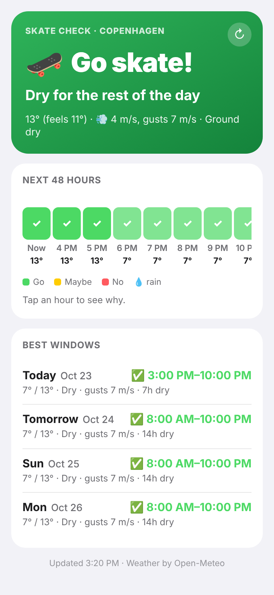
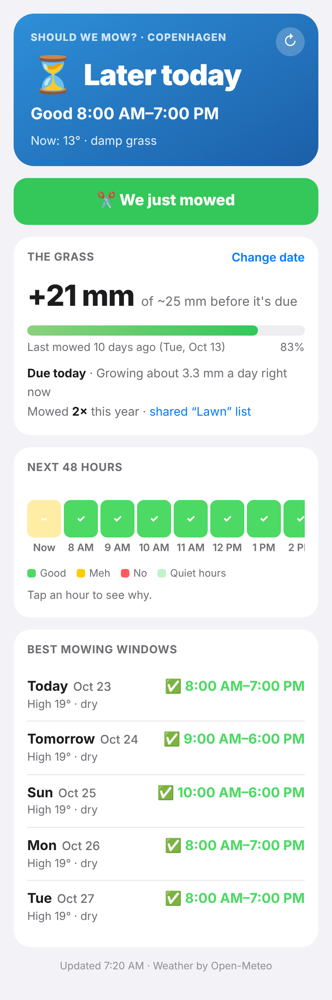
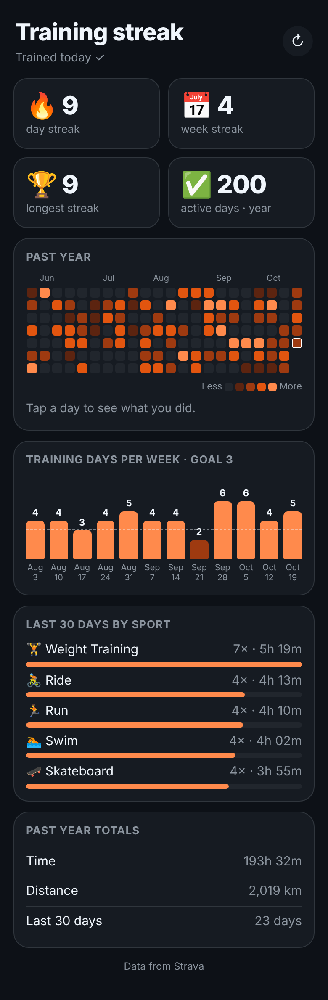

# iPhone Dashboard (Scriptable)

A personal dashboard that runs on your iPhone inside the free [Scriptable](https://apps.apple.com/app/scriptable/id1405459188) app:

- **Weather**: now, the next 24 hours and the next 7 days (Open-Meteo, no account needed)
- **Calendar**: today and the coming week, from every calendar on your phone
- **Reminders**: open reminders. Tap one to tick it off (with Undo).
- **Weight journey**: current weight, how much you've lost, progress to your goal, weekly trend, a chart, and an estimated goal date
- **Last workout**: your latest Strava activity with a route map, this week's totals and recent activities
- **Widgets**: small, medium, large and lock-screen sizes

All data stays on your phone. Your Strava login is stored in the iOS Keychain.

---

## 1. Install (2 minutes)

1. Install **Scriptable** from the App Store.
2. Get `Dashboard.js` into Scriptable. Either:
   - save the file to **Files → iCloud Drive → Scriptable**, or
   - open Scriptable, tap **+**, paste the whole contents of `Dashboard.js`, tap the title at the top and rename it to **Dashboard**.
3. Tap **Dashboard** in Scriptable to run it. It asks for your units, name and goal weight, and offers to connect Strava (you can skip this and do it later from ⚙︎).
4. Allow **Location**, **Calendars** and **Reminders** when iOS asks.

You can change your name, goal weight, units and Strava from the **⚙︎** button in the top right of the dashboard. The ↻ button refreshes everything.

## 2. Connect Strava (3 minutes)

From ⚙︎ → **Connect Strava**:

1. Tap **Open Strava API page** and sign in. Create an app with:
   - Application Name: anything, e.g. *My Dashboard*
   - Category: anything
   - Website: `http://localhost`
   - **Authorization Callback Domain: `localhost`** ← this one matters
2. Copy the **Client ID** and **Client Secret** into the two fields, then tap **Continue**.
3. Choose **Sign in here** and approve.
   - If you normally sign in to Strava with **Google or Apple**, choose **Sign in with Safari** instead. After you approve, Safari shows a "can't connect to localhost" page. That's expected. Tap the share button → **Copy**, close Safari, and paste the link into the box.

## 3. Send your weight from Apple Health (5 minutes, one-time)

Scriptable can't read Apple Health directly, so a Shortcut hands your weight over. Build it once:

1. Open **Shortcuts** → **+** → name it **Send weight to Dashboard**.
2. Add **Find Health Samples**:
   - Type: **Weight**
   - Filter: **Start Date** is in the last **365 days**
   - Sort by **Start Date**, Order **Oldest First**, Limit **off**
3. Add **Repeat with Each** (it picks up the Health Samples automatically).
4. Inside the repeat, add a **Text** action and build exactly this, with no spaces:

   `weight;`**`Start Date`**`;`**`Value`**

   - For **Start Date**: insert the *Repeat Item* variable, tap it, pick **Start Date**, then set **Date Format → ISO 8601**.
   - For **Value**: insert *Repeat Item* again, tap it and pick **Value**.
5. After **End Repeat**, add **Combine Text**: *Repeat Results*, separator **New Lines**.
6. Add Scriptable's **Run Script** action: Script **Dashboard**, Parameter **Combined Text**. Tap the arrow to show more options and turn **Run In App** off.
7. Run it once. You should see: *"Dashboard saved 123 weight entries. Latest: 84.2 kg."*

**Make it automatic:** Shortcuts → **Automation** → **+** → **Time of Day** (e.g. daily 09:00) → **Run Immediately** → pick *Send weight to Dashboard*. You could also use **App → Health → Is Closed**, so it runs whenever you've just logged a weight.
> iOS blocks Health data while the phone is locked, so pick a time when you're usually using your phone.

Your scale app (Withings, Renpho, etc.) or manual entries in Health all work, as long as they end up in Apple Health.

## 4. Add widgets

Long-press the home screen → **Edit → Add Widget** → **Scriptable** → pick a size. Then long-press the new widget → **Edit Widget**:

- **Script:** Dashboard
- **When Interacting:** Run Script (tapping the widget opens the full dashboard)
- **Parameter** (small widgets only):

| Parameter | Small widget shows |
|---|---|
| *(empty)* or `weather` | Weather and your next event |
| `weight` | Weight, change since you started, and a 30-entry trend line |
| `workout` | Last Strava workout |
| `agenda` | Your next 4 events |

The medium widget shows weather, weight, your next 2 events and your last workout. The large one adds a weight trend line, more events and reminders. On the lock screen, rectangular, inline and circular widgets are supported too.

You can see how each widget looks from ⚙︎ → **Preview widgets**.

**Want an app icon?** Shortcuts → **+** → Scriptable **Run Script** → *Dashboard* (leave **Run In App** on) → share button → **Add to Home Screen**.

## Optional tweaks

At the top of `Dashboard.js` there's a `CONFIG` block where you can:

- set a fixed `location` instead of GPS
- show only certain `calendars` or `reminderLists` (by name)
- change the order of the cards (`sections`)
- change how many days of calendar to show and the default chart range

## Troubleshooting

- **"N line(s) couldn't be read"** after running the Shortcut: the Start Date in the Text action isn't set to **ISO 8601** (step 3.4).
- **Weather says location unavailable:** allow location for Scriptable in Settings → Privacy → Location Services, or set `CONFIG.location`.
- **Strava stopped working:** use ⚙︎ → Strava → Continue to sign in again. Your Client ID and Secret are remembered.
- **Widget looks out of date:** iOS decides how often widgets refresh (roughly every 15–60 minutes). Opening the dashboard always fetches fresh data.

---

# 🛹 Skate Check: "Can I skate today?"

`SkateCheck.js` is a separate widget that tells you whether the streets are skateable now, and when today's best dry window is.



**How it decides:** it tracks the last 24 hours of rain and how fast the ground dries (sun, wind, warmth and humidity speed this up, cold humid nights slow it down). So it knows the street is still wet a couple of hours after the rain stops. Each hour is then rated:

| | When |
|---|---|
| ✅ **Go** | Dry ground, no rain, calm enough, not too cold |
| 🤔 **Maybe** | Ground still drying, 35–60% chance of rain, gusty, cold (under 5°C) or dewy |
| ❌ **No** | Raining, wet ground, rain likely, strong gusts (12 m/s+), snow or ice risk |

**The verdict on your widget:**
- **🛹 Go skate!**: dry right now, and it tells you until when
- **⏳ Later today**: a dry window is coming, e.g. *Dry 16:00–19:00*
- **🤔 Maybe**: skateable-ish, with the reason
- **☔️ Not now**: with the next dry window, e.g. *Next: Tomorrow 10:00–15:00*

It also schedules a **notification 30 minutes before today's dry window starts**, so you get a nudge without having to check.

### Install
Run the installer below (or copy `SkateCheck.js` into Scriptable's iCloud folder), then add a Scriptable widget and set Script to **SkateCheck**. All sizes work:
- **small**: the verdict
- **medium**: adds a colour-coded timeline of the next 15 hours
- **large**: adds the best windows for the next 3 days
- **lock screen**: rectangular, inline and circular

Tap the widget, or run the script in Scriptable, for the full view. It has a 48-hour timeline (tap any hour to see why it's rated that way) and the best window for each of the next 4 days.

### Tweak it
The `CONFIG` block at the top of `SkateCheck.js` lets you change:
- your skate hours (default 8:00–22:00)
- the minimum temperature, the gust limit and the rain-chance cutoff
- whether it only suggests windows in **daylight**
- whether notifications are on, and how many minutes ahead they arrive

---

# 🌱 Should We Mow?

`ShouldWeMow.js` answers both halves of the question: **does the lawn need it**, and **can you mow right now?**



**Does it need it?** It estimates how much the grass has grown since the last mow from the daily temperature and rain. This uses the turf-science "growth potential" curve: cool-season grass grows fastest around 20°C and hardly at all below ~8°C, and dry spells slow it down. The lawn counts as **due** once it has grown about a third of your cut height (default: cut to 50 mm, so it's due at roughly +25 mm). In a cold spell it tells you the lawn is resting.

**Can you mow now?** It rates each hour:
- **Good:** dry grass and daylight.
- **Meh:** grass a bit damp, a 40–60% chance of rain, soft ground after 10 mm+ of rain, very hot (30°C+), or very windy.
- **No:** rain, wet grass (rain *or morning dew*), soggy ground after 20 mm+ of rain, frost, or dark.

It only suggests windows during **neighbour-friendly hours**: weekdays 8–20, Saturday 9–18 and Sunday 10–18 by default, and you can change these. Windows must be long enough to finish the job (default 60 minutes).

**What the widget says:**
- **✂️ Mow today!** — "Good until 19:00"
- **⏳ Later today** — "Good 13:00–19:00" (e.g. waiting for the dew to dry)
- **😌 Not yet** — "Due in ~3 days (Mon)"
- **🙅 Not right now** — "Next: Sat 10:00–17:00"
- **💤 Lawn's resting** — too cold to grow
- If the lawn is due tomorrow but tomorrow is a washout, it says **"Rain tomorrow!"** and suggests today.

It also sends a **notification 30 minutes before** a good window on days the lawn is due.

### Logging a mow (and sharing it with your household)

Tap **✂️ We just mowed** in the app. Mows are saved as completed reminders in a **Reminders list called "Lawn"**, which is created automatically. **Share that list** (Reminders → Lawn → ⋯ → Share List) and everyone's phone sees the same mowing history, whoever did the mowing.

**Hands-free option:** make a Shortcut with Scriptable's **Run Script** action, Script **ShouldWeMow**, Parameter `mowed`. Then just say *"Hey Siri, we mowed"*, or add it to your home screen as a one-tap button.

The first time you open it, it asks roughly when you last mowed so it can start estimating straight away. You can fix the date later with **Change date**.

### Tweak it
The `CONFIG` block at the top of `ShouldWeMow.js` lets you change:
- mowing hours for each weekday (`null` = never on that day)
- `cutHeight`, how long a mow takes, and `grassType` (`"warm"` for Bermuda, zoysia and similar grasses)
- `watered: true` if you water the lawn
- notifications

---

# 🔥 Training Streak

`TrainingStreak.js` turns your Strava history into a GitHub-style grid. Each square is a day, and the brighter the orange, the longer you trained. It also shows your current streak.



- **Day streak:** consecutive days with a workout. If you haven't trained yet today, your streak stays alive until midnight, and the widget nudges you: *"Train today to keep it 🔥"*.
- **Week streak:** consecutive weeks hitting your weekly goal (default 3 training days). This is the kinder streak, because rest days don't break it.
- **Longest streak**, active days this year, and total time and distance.

**Widgets:**
- **small:** your streak and the last 9 weeks.
- **medium:** day and week streaks, plus the last 14 weeks with month labels.
- **large:** 22 weeks plus stats.
- **lock screen:** rectangular, inline and circular.

Tap the widget for the full view: the whole year (tap any day to see what you did, then tap an activity to open it in Strava), training days per week against your goal, and the last 30 days broken down by sport.

**Strava:** it uses the same Strava connection as the Dashboard, so connect it there first (⚙︎ → Connect Strava). It keeps about a year of activities on your phone, checks for new ones every 15 minutes, and does a full re-sync once a day.

### Tweak it
The `CONFIG` block at the top of `TrainingStreak.js` lets you change:
- `theme`: `"strava"` (orange) or `"github"` (green)
- `weeklyGoal`, and the minutes it takes to reach each shade (`levels`)
- `minMinutes`, so a 4-minute walk doesn't count
- `sports`, to only count certain sports, e.g. `["Run", "Ride"]`

---

## Installer (all scripts)

Create a new script in Scriptable, paste this in and run it. Run it again any time to update them all.

```js
const base = "https://raw.githubusercontent.com/gigasnail/gigasnail.github.io/iphone-dashboard/iphone-dashboard/";
const fm = FileManager.iCloud();
for (const name of ["Dashboard.js", "SkateCheck.js", "ShouldWeMow.js", "TrainingStreak.js"]) {
  fm.writeString(fm.joinPath(fm.documentsDirectory(), name), await new Request(base + name).loadString());
}
const a = new Alert(); a.title = "Installed ✅"; a.message = "All scripts are up to date."; a.addAction("OK"); await a.presentAlert();
```
